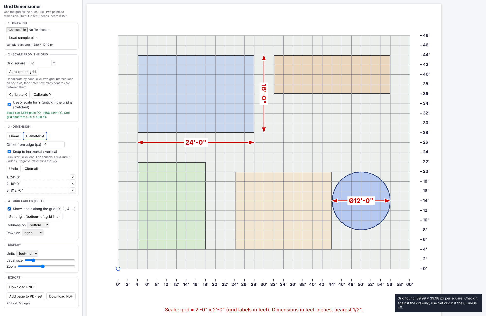

# Grid Dimensioner

A browser app for dimensioning gridded plans and elevations (trade-show / exhibit drawings) in feet-inches, using the drawing's own grid as the ruler. Everything runs in the browser: your drawing is never uploaded anywhere.



## What it does

- Loads a PNG / JPG, or a page of a PDF.
- **Auto-detects the grid** (pixels per square) on each axis, or lets you calibrate by clicking two grid intersections and entering the number of squares between them. Per-axis scales are supported for stretched grids.
- Click two points to add a **linear dimension**, or two points on a circle's edge for a **diameter (Ø)**. Optional offset from the edge draws extension lines. Shift or "snap" keeps lines horizontal or vertical.
- Labels are feet-inches to the nearest 1/2" (`9'-0 1/2"`), or inches if you prefer.
- **Grid labels in feet** along two sides (0', 2', 4' ... for a 2' grid) so you can read distances at a glance.
- One footer scale line: `Scale: grid = 2'-0" x 2'-0" (grid labels in feet). Dimensions in feet-inches, nearest 1/2".`
- Exports PNG, or a multi-page PDF (add each page to the PDF set, then download).

## Run it

```bash
python3 -m http.server 8080      # then open http://localhost:8080
```

No build step. PDF input loads pdf.js from cdnjs the first time you open a PDF (needs internet); PNG/JPG work offline.

## Test it

```bash
npm test                          # unit tests for the math (Node 20+, no dependencies)
pip install playwright && playwright install chromium
python3 tests/e2e.py              # drives the app in a real browser: auto-detect, dimension, export
```

GitHub Actions runs both on every push (`.github/workflows/ci.yml`).

## Put it on GitHub and try it online

1. Create a new repository on GitHub and push this folder to the `main` branch.
2. In the repo go to **Settings > Pages > Build and deployment > Source: GitHub Actions**.
3. Push again (or run the "Deploy to GitHub Pages" workflow). The app appears at `https://<your-user>.github.io/<repo>/`.
4. Use **Load sample plan** to try it without a drawing of your own.

## Limitations (v0.1)

- You choose each dimension by clicking; the app does not find edges for you. It makes the scale, math, formatting, labels and export automatic.
- Auto-detect works on clean grids. On a real 5-page exhibit-render PDF it found the pitch within about 0.5% on 4 pages, and on the 5th the vertical spacing was wrong (the app caught it and fell back to the X scale). Busy artwork can confuse it. If the 0' line or the pitch looks off, use **Set origin** or **Calibrate X/Y**. When the Y spacing looks implausible it falls back to the X scale and says so.
- Accuracy is limited by how precisely you click: zoom in for edges. Expect about +/-1-2" on large renders.
- Heights come only from elevations. A plan view carries no height information.
